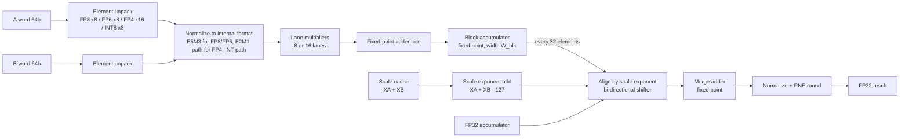

# MXDOTP-2: A Full Microscaling (MX) Datapath for RISC-V

> Working title. A multi-format, block-native, quantization-capable extension of the
> MXDOTP idea, evaluated end-to-end on real models.

**Status:** planning / Phase 0
**Baseline we build on and cite:** G. Islamoglu et al., *MXDOTP: A RISC-V ISA Extension for Enabling Microscaling (MX) Floating-Point Dot Products*, IEEE ASAP 2025 (arXiv:2505.13159).
All results in this repo must be measured by us. Nothing is copied from the baseline paper except what is cited as baseline context.

---

## 1. Motivation

MX formats (OCP MX v1.0) pair a shared 8-bit power-of-two scale (E8M0) per block of 32
elements with small private elements (FP8, FP6, FP4, INT8). They keep range *and*
precision at low bitwidth, but executing them on a normal RISC-V core is slow because one
scaled dot step needs more operands than the register file provides.

The baseline MXDOTP shows that a fused scaled dot-product-accumulate instruction fixes
this for **MXFP8 matmul**. It leaves open problems:

| Gap in baseline | Consequence |
|---|---|
| Only MXFP8 | No FP6 / FP4 / INT8, so no use of the densest formats |
| 8 elements per instruction vs block size 32 | Scales re-fetched and re-applied 4x per block |
| Scales consume one of three SSRs | Fewer streams available for kernels |
| No quantize instruction | Cannot produce MX outputs; every layer boundary falls back to software |
| ~80% utilization | Init, store and loop overhead is visible |
| Conservative 95-bit exact accumulator | Possible area and energy waste |
| Only a matmul kernel, no accuracy study | Unclear real-model benefit |

## 2. Goal and hypotheses

**Goal:** a complete MX execution path on a small RISC-V cluster: *multiply, accumulate,
scale, and re-quantize*, with measured accuracy on real models.

These are hypotheses to be confirmed or refuted by experiments (Section 7):

- **H1** Multi-format support gives up to ~2x element throughput for MXFP4 over MXFP8 at modest area cost.
- **H2** A native 32-element block mode lowers energy per MAC by cutting scale traffic and accumulator realignment.
- **H3** A fused quantize instruction removes the software bottleneck between layers.
- **H4** A narrower accumulator (e.g. 48 to 64 bits instead of 95) loses negligible accuracy on real workloads and saves area/energy.
- **H5** Utilization above 90% is reachable with better loop and accumulator handling.

## 3. Contributions (target)

1. A multi-format MX dot-product unit: MXFP8 (E5M2/E4M3), MXFP6 (E3M2/E2M3), MXFP4 (E2M1), MXINT8.
2. A native block-32 execution mode with a scale cache that frees the third SSR.
3. A fused MX quantization unit (`mxmax`, `mxquant`) for block max, scale selection and element conversion.
4. A bit-accurate golden model and a verification suite against the OCP MX spec.
5. End-to-end evaluation: accuracy plus performance, area and power, with ablations.
6. Open-source RTL, kernels and scripts for full reproducibility.

---

## 4. Architecture

### 4.1 System view

```
                     +---------------------- Snitch Cluster (8 cores) ----------------------+
                     |                                                                      |
  External memory <--+-- DMA core <--> 128 KiB L1 SPM (32 banks) <--> logarithmic interconnect|
                     |                         ^   ^   ^                                    |
                     |                         |   |   |                                    |
                     |        +----------------+---+---+-------------------+                |
                     |        |            Snitch core complex              |   x8          |
                     |        |                                             |                |
                     |        |  Int core -> FREP sequencer                 |                |
                     |        |  SSR0 (A) ----------------+                 |                |
                     |        |  SSR1 (B) ----------------+--> FP Subsystem |                |
                     |        |  SSR2 (C / out stream) ---+                 |                |
                     |        |                                             |                |
                     |        |  FP RF (3R/1W, unchanged)                   |                |
                     |        |  MX Scale Cache (NEW)  <-- scale loads      |                |
                     |        |  MX CSRs (NEW): format, block size, round   |                |
                     |        |                                             |                |
                     |        |  FPU: FMA | COMP | CAST | MX-DOTP2 (NEW)   |                |
                     |        |                    | MX-QUANT (NEW)         |                |
                     |        +---------------------------------------------+                |
                     +----------------------------------------------------------------------+
```

Unchanged: Snitch core, FP register file ports (3 read, 1 write), SSR and FREP concepts.
New: scale cache, MX CSRs, MX-DOTP2 unit, MX-QUANT unit.

### 4.2 MX-DOTP2 datapath (multi-format, block-aware)



Key design decisions:

- **Lane count per format.** One 64-bit input word carries 8 FP8/FP6(padded to 8 bits)/INT8 elements or 16 FP4 elements. The lane array is built as 16 narrow FP4-capable multipliers that fuse pairwise into 8 wider ones for FP8/FP6/INT8. This shares logic instead of duplicating units.
- **FP6 packing.** v1 streams FP6 in 8-bit containers (simple, no throughput gain over FP8 but spec-complete). v2 explores true 6-bit packing with a re-alignment buffer (see Phase 5).
- **Two-level accumulation (block-native mode).**
  1. Products within a block are summed exactly in a *block accumulator* with no scale applied. Its width depends only on element-format range, so it is much narrower than a 95-bit accumulator that must also hold the aligned FP32 value.
  2. After the 32nd element (4 beats for FP8, 2 for FP4), the block sum is aligned once using `XA + XB` and merged into the FP32 accumulator, then rounded once.
  3. Rounding therefore happens once per block rather than being exact across the whole dot product. The accuracy impact of this is measured (H4, Section 7).
- **Compatibility mode.** A CSR bit selects the baseline behaviour (scale applied every instruction, single rounding) so we can compare directly and verify bit-exactness against the baseline unit.
- **Pipeline.** Target 3 to 4 stages with throughput of one instruction per cycle. Stage count is a parameter.

### 4.3 Scale cache (replaces the scale SSR)

- Small register structure holding the `(XA, XB)` pairs for the next N blocks (N = 4 to 8, parameter).
- Filled by a lightweight `mxscale.ld` or by a bulk load from a packed scale array, so the SSR stream budget returns to A, B, and output.
- Selected implicitly by a block counter in MX-DOTP2, which increments each time a block completes. This removes the `sl` field from the per-instruction encoding.

### 4.4 MX-QUANT unit

Produces MX outputs from FP32 results so the next layer can consume them directly.

```
  32 x FP32 values
       |
       v
  [mxmax]  -> running max of exponent over the block      (pass 1)
       |
       v
  scale X = emax_block - emax_element_format              (E8M0, clamped, 0xFF reserved for NaN)
       |
       v
  [mxquant] -> value * 2^-X, round (RNE), saturate to element format,
               pack into 64-bit words                      (pass 2)
```

- `mxmax rd, rs1`: reduces the exponent maximum across values written to a running register.
- `mxquant rd, rs1, rs2`: converts FP32 values using the current scale into packed MX elements; the scale byte is written to a separate scale stream.
- Rounding mode and saturation behaviour follow the OCP spec; special values (NaN, Inf, zero blocks) are covered by directed tests.
- Fused accumulate-and-quantize at the end of a GEMM tile is evaluated as an optimization.

### 4.5 ISA sketch

| Instruction | Operands | Meaning |
|---|---|---|
| `mxdotp2 rd, rs1, rs2` | acc, A word, B word (via SSR) | Scaled dot-accumulate using the scale cache; format and block size from CSRs |
| `mxscale.ld ...` | scale source | Load scale pairs into the scale cache |
| `mxmax rd, rs1` | FP32 in | Update running block exponent max |
| `mxquant rd, rs1, rs2` | FP32 in, scale | Quantize to MX element and pack |
| CSR `mxcfg` | fields | element format (FP8-E5M2/E4M3, FP6-E3M2/E2M3, FP4, INT8), block size (default 32), accumulate mode (block-native / compat), rounding |

Encodings will be finalized in Phase 2 after checking opcode space and the Snitch FP offload interface.

---

## 5. Software stack

- **Kernels:** GEMM (tiled, double-buffered with DMA), plus a fused attention-score block (QK^T) and a linear layer with quantized output.
- **Layout:** helper to pack elements and scales into SSR-friendly streams.
- **Compiler access:** inline-assembly macros first, LLVM builtins later.
- **Higher-precision ops:** softmax, LayerNorm and residual adds stay in FP32 or BF16; the pipeline mixes MX and higher precision as in MX papers.

## 6. Repository layout

```
mxdotp2/
├── hw/                 SystemVerilog: mx_dotp2, mx_quant, scale cache, FPU integration
│   ├── rtl/
│   └── tb/
├── sw/                 kernels, macros, startup code, build scripts
├── model/              Python golden model, bit-accurate MX emulation (spec-driven)
├── verif/              random + directed tests, RTL vs golden model (Verilator / cocotb)
├── eval/
│   ├── accuracy/       DeiT / small LLM block accuracy under MX emulation
│   ├── perf/           cycle counts, utilization, roofline
│   └── ppa/            area/power/timing result parsing and plots
├── synth/              open-PDK flows (Yosys + OpenROAD), configs, reports
├── third_party/        Snitch, cvfpu (pinned commits, submodules)
├── docs/               architecture notes, ISA spec, paper (LaTeX)
├── .github/workflows/  CI: lint, golden-model tests, Verilator regressions
├── LICENSE
└── README.md
```

---

## 7. Evaluation plan

### Accuracy
- Bit-exact check of the unit against the golden model (millions of random vectors plus directed corner cases: subnormals, max/min exponents, NaN/Inf, all-zero blocks, scale extremes).
- Model-level accuracy using MX emulation (e.g. Microsoft's MX emulation library as a cross-check, our own model as reference): DeiT-Tiny top-1, plus a small transformer or LLM block perplexity.
- Sweep: element format x accumulator width x accumulation mode (compat vs block-native).

### Performance
- Cycles and FPU utilization per kernel for FP32, FP8, FP6, FP4, INT8.
- Our re-run of the baseline MXDOTP kernel as the reference point.
- Roofline with memory bandwidth, then a multi-cluster projection.

### Area / power / timing
- Same open-PDK flow for baseline and ours. **Report relative numbers only**; absolute numbers are not comparable to the baseline paper's proprietary 12 nm flow.
- Power from gate-level simulation switching activity on real workload traces.

### Ablations (one change at a time)
1. Baseline MXFP8 unit re-synthesized
2. + block-native mode
3. + scale cache
4. + multi-format
5. + quantizer
6. Accumulator width sweep
7. Utilization optimizations

---

## 8. Roadmap

| Phase | Deliverable | Exit criterion |
|---|---|---|
| 0. Reproduce | Snitch + baseline MXDOTP kernels running in Verilator | Baseline results re-measured and documented |
| 1. Golden model | Python MX model (all four formats, dot, quantize) | Matches OCP spec examples and the emulation library |
| 2. Spec | ISA encoding, CSRs, microarchitecture doc | Reviewed design doc |
| 3. RTL v1 | Multi-format dot unit in compat mode | Bit-exact vs golden model, passes regression |
| 4. Block-native + scale cache | Two-level accumulation, SSR budget restored | Accuracy study of rounding difference; kernels updated |
| 5. Quantizer | `mxmax` / `mxquant`, end-to-end layer | Layer output matches golden model |
| 6. Utilization | Nested FREP, accumulator init, double-buffering | Measured utilization target |
| 7. PPA | Open-PDK synthesis and power for all ablations | Result tables and plots |
| 8. Evaluation + paper | Full accuracy + performance study, artifact | Reproducible scripts, draft submitted |

Suggested first month: Phases 0 and 1 only. The golden model is cheap, de-risks everything
after it, and already supports a software-only accuracy study if hardware work slips.

## 9. Risks

| Risk | Mitigation |
|---|---|
| Hardware effort too large | Staged phases; golden model plus accuracy study is a publishable fallback |
| Block-native rounding hurts accuracy | Keep compat mode; report the tradeoff honestly |
| Open-PDK numbers differ from the baseline paper | Compare only against our own re-synthesized baseline |
| FP6 packing complexity | Ship 8-bit container version first |
| Opcode/encoding conflicts in Snitch | Check early in Phase 2 |

## 10. Research integrity

- Cite the baseline MXDOTP paper and the OCP MX specification as prior work.
- Do not reuse the baseline paper's text, figures or numbers as our results.
- Every table in our paper must trace to a script in `eval/` and a pinned commit.

## 11. Getting started (to be filled as phases complete)

```bash
git clone --recursive <repo-url> mxdotp2
cd mxdotp2
# Phase 0: build Verilator model of the baseline Snitch cluster, run baseline kernels
# Phase 1: python -m pytest model/tests
```

## 12. License

Hardware and software: Apache-2.0 or Solderpad (to match Snitch/cvfpu), decided before first public release.

## 13. References

1. G. Islamoglu et al., "MXDOTP: A RISC-V ISA Extension for Enabling Microscaling (MX) Floating-Point Dot Products," ASAP 2025, arXiv:2505.13159.
2. B. D. Rouhani et al., "Microscaling Data Formats for Deep Learning," 2023, arXiv:2310.10537.
3. OCP Microscaling Formats (MX) Specification v1.0.
4. F. Schuiki et al., "Stream Semantic Registers," IEEE Trans. Comput., 2021.
5. F. Zaruba et al., "Snitch," IEEE Trans. Comput., 2021.
6. L. Bertaccini et al., "MiniFloats on RISC-V Cores," IEEE TETC, 2024.
## Author & Citation

- **Author:** Ishan Pandey ([isdp0415@gmail.com](mailto:isdp0415@gmail.com))
- **Repository:** [IshanPandey32/mirex](https://github.com/IshanPandey32/mirex)